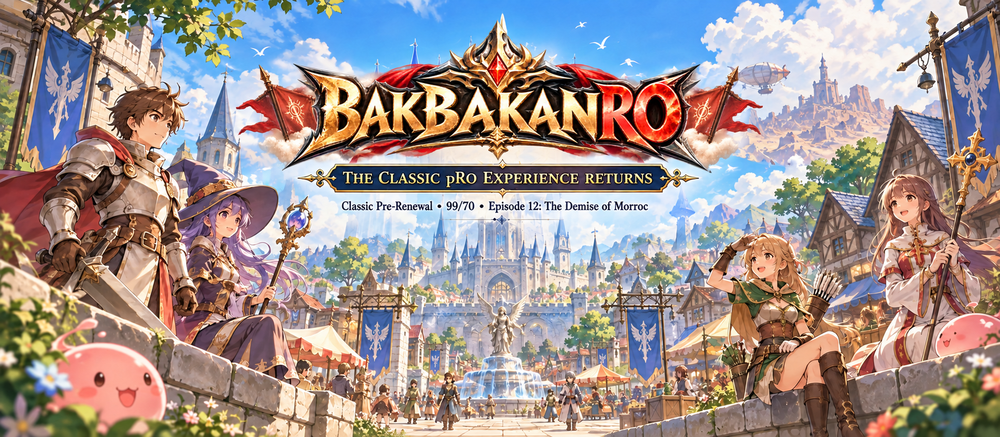

# The Classic pRO Experience Returns

Welcome to the **official BakbakanRO Game Wiki** — your player guide for server information, progression, features, and Episode 12 content.

**Classic Pre-Renewal • 99/70 • Episode 12: The Demise of Morroc**

The server is built around the classic Ragnarok Online experience, with a focus on character progression, MVP hunting, PvP, War of Emperium, and the world of Rune-Midgard before Third Jobs.

## Official Links

- [Official Website](https://bakbakanro.com/home)
- [Community Page](https://bakbakanro.com/home/community)
- [Discord](https://bakbakanro.com/home/community) — use the Discord link available on the Community page.

## Start Here

| Guide | What you'll find |
| --- | --- |
| [Server Information](server-information.md) | Core rates, level limits, class availability, and gameplay settings |
| [Getting Started](getting-started.md) | Account, client, patching, first login, and beginner steps |
| [Server Features](server-features.md) | PvP, WoE, MVP hunting, rankings, events, and player services |
| [Premium Account Services](premium-account-services.md) | Premium benefits, activation, notifications, Kafra Premium services, and NPC locations |
| [Claiming Rewards](claiming-rewards.md) | Event and server reward claiming through Bunny Corp. Staff (Wendy) |
| [Episode 12: The Demise of Morroc](episode-12-the-demise-of-morroc.md) | Episode scope, item/drop rules, maps, Satan Morroc, and related content |
| [MVP & PK Maps](mvp-pk-maps.md) | Current Episode 12 MVP maps where PK is enabled |

## Server at a Glance

| Setting | Value |
| --- | --- |
| Game Type | Pre-Renewal |
| Maximum Level | 99/70 |
| Maximum Stat | 99 |
| Maximum ASPD | 190 |
| Instant Cast | 150 DEX |
| Base EXP | x1 |
| Job EXP | x1 |
| Non-MVP Drop Rate | 90% |
| MVP Default Drops | x1 |
| Classes | Transcendent + classic Expanded classes |
| Current Episode | Episode 12: The Demise of Morroc |

## Permanently Free-to-Play & Ready for Action

The server is **permanently free-to-play** and is designed to help players get ready for PvP, War of Emperium, and MVP hunting without spending excessive time preparing basic equipment and supplies.

- Players receive **free Zeny** to purchase the equipment and supplies they need.
- In-game shops offer **Armor, equipment, Cards, Headgears, Potions, consumables, supplies, and other essentials** that can be purchased using Zeny.
- A **Job Changer NPC** is available for faster class progression.
- **Miracle Tonic** can be purchased in-game and used as needed to quickly reach the maximum Base Level of **99**.

The goal is simple: spend less time preparing and more time testing builds, fighting in PvP, joining WoE, and hunting MVPs.

Premium is an optional account-wide service and is **not required to access the core game**.

## Classic Ragnarok Experience

The server keeps progression centered on the classic era. Players can advance through regular and Transcendent class paths, with classic Expanded options including **Super Novice, Taekwon Kid, Soul Linker, Taekwon Master, Ninja, and Gunslinger**.

Third Jobs and later-era advanced class progression are not part of the server's Episode 12 setting.

Whether your goal is leveling, farming equipment and cards, hunting MVPs, building for PvP, or competing in War of Emperium, this wiki is intended to be the official reference for the systems available on the server.

## Current Episode

### Episode 12: The Demise of Morroc

The world has reached the era of **The Demise of Morroc**, where the destruction surrounding Morroc and the threat of **Satan Morroc** define one of classic Ragnarok Online's major story periods.

The playable world is focused on content available up to Episode 12 and the earlier episodes leading into it. Selected headgears, Cash Shop items, and Cash Box items may include content up to Episode 13 without changing the server's main Episode 12 progression.

[Read the Episode 12 overview →](episode-12-the-demise-of-morroc.md)

## About This Wiki

This wiki is the official player reference for the server. It will continue to expand with detailed guides for classes, maps, dungeons, monsters, MVPs, items, NPCs, PvP, WoE, Premium services, server rules, and other supported systems.

Server mechanics may change as development continues. Important changes will be reflected here and through official server announcements.
