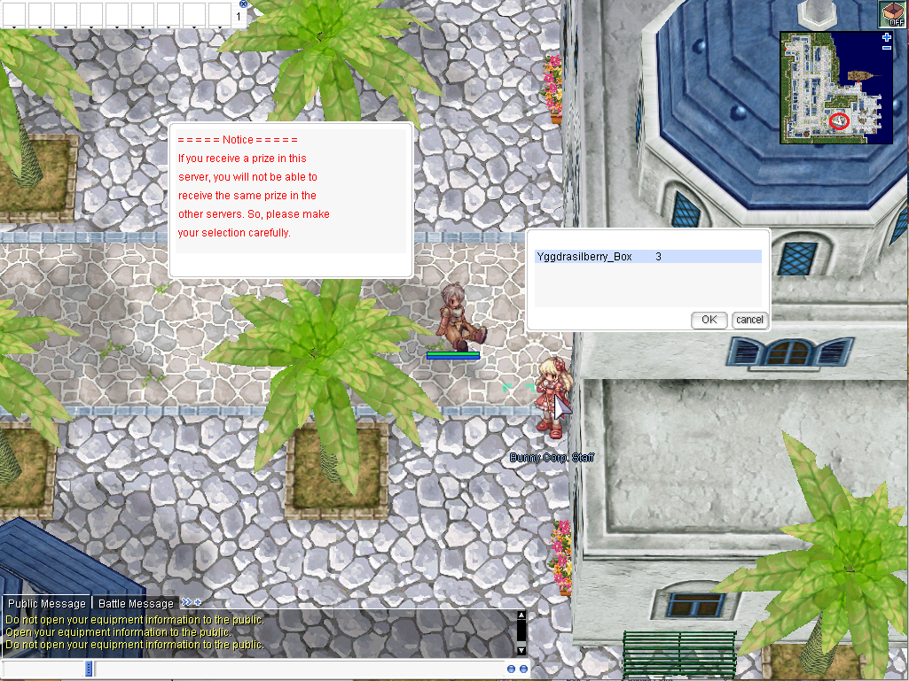
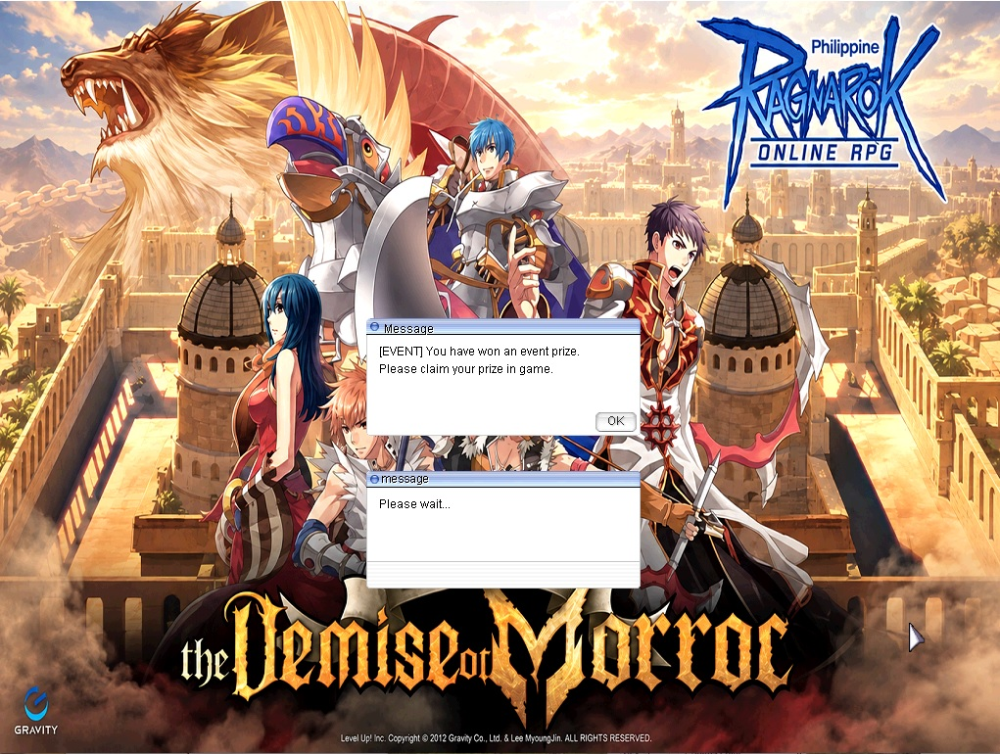

# Claiming Rewards

The server uses **Bunny Corp. Staff (Wendy)** as the reward-claim NPC for eligible event prizes and other server rewards. Wendy is a familiar NPC from the official pRO era and serves as the central place for claiming pending rewards.

## NPC Location

Look for **Bunny Corp. Staff (Wendy)** in Alberta:

| NPC | Town | Coordinates |
| --- | --- | --- |
| Bunny Corp. Staff (Wendy) | Alberta | `148,53` |

The screenshot below shows the NPC location in-game:

## How Reward Claiming Works

When you win an event or receive a reward that is assigned to your account or character, visit **Bunny Corp. Staff (Wendy)** in Alberta to claim it.

Use this NPC whenever a server event, promotion, or reward notice instructs you to collect a prize through the reward-claim system.

## Reward Notification

If you have an available reward waiting at Wendy, a notification will appear when you log in.

The notification lets you know that a reward is ready to be claimed, so you can travel to Alberta and speak with **Bunny Corp. Staff (Wendy)**.

