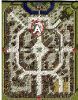

# Gym Pass — Ripped Cabus

**Ripped Cabus** is the Gym Pass NPC in Prontera. Training with him increases your character's item carrying capacity.

## NPC Location

| NPC | Map | Coordinates |
| --- | --- | --- |
| Ripped Cabus | Prontera | `150,280` |

Ripped Cabus can be found in **Prontera at `150,280`**.

## What You Need

Bring **1 Gym Pass** each time you want to increase your carrying-capacity training level.

Each successful training session consumes **1 Gym Pass**.

## Where to Get a Gym Pass

The **Gym Pass** can be purchased from the **Cash Merchant**.

Purchase a Gym Pass before visiting Ripped Cabus if you want to increase your carrying-capacity training.

## How It Works

1. Purchase a **Gym Pass** from the Cash Merchant.
2. Talk to **Ripped Cabus** in Prontera at `150,280`.
3. Choose **Yes** when he asks if you are ready to train.
4. If you have a Gym Pass, he will consume one pass and increase your carrying-capacity training by one level.
5. Repeat the process if you want to increase it further.

Your Gym Pass training can be increased a maximum of **10 times**.

| Training Status | Result |
| --- | --- |
| 0–9 previous sessions | You may train again with 1 Gym Pass |
| 10 completed sessions | Maximum carrying-capacity training reached |
| No Gym Pass | Training cannot continue |

## Maximum Training Limit

Ripped Cabus allows a character to increase this carrying-capacity training up to **10 times**.

After reaching the tenth training level, he will no longer accept additional Gym Pass training for that character.

## Restoring Previous Training

The dialogue option **“Um, my workouts wore off.”** is used to restore your previously recorded Gym Pass training level if the carrying-capacity skill is no longer active.

If the character already has prior Gym Pass training recorded, Ripped Cabus will reapply that same training level. This recovery option does **not** increase the level beyond what you previously earned.

If the character has never trained with Ripped Cabus before, there is no previous training level to restore.

## Quick Reference

- **NPC:** Ripped Cabus
- **Location:** Prontera `150,280`
- **Required Item:** Gym Pass
- **Where to Buy:** Cash Merchant
- **Cost per Training:** 1 Gym Pass
- **Maximum Trainings:** 10
- **Purpose:** Increase item carrying capacity
- **Recovery Option:** “Um, my workouts wore off.” restores previously recorded training

Return to [NPC & Services](npc-services.md) for other NPC guides.
