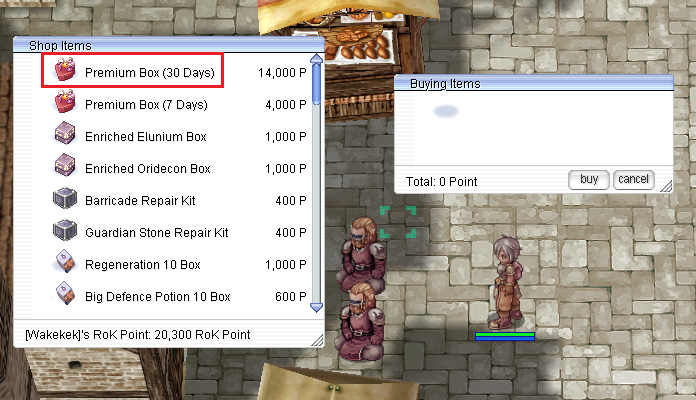
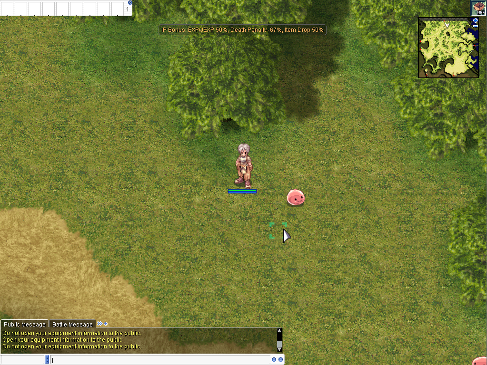

# Premium Account Services

Premium is an optional account-wide service that provides additional convenience and progression benefits while preserving BakbakanRO's classic gameplay direction.

## Premium Benefits

While Premium is active, the account receives:

- **+50% EXP Rate**
- **+50% Drop Rate**
- **50% Reduced Death Penalty**
- **Increased Kafra Storage**
- **Access to the Dungeon Teleport NPC and Agit Maps**
- **Change Name Service** — a **Ticket of Identification is still required** when using this service.
- **Repair Service**

## How to Become Premium

To activate Premium, obtain a **Premium Box** and use the item on your account. Simply use the Premium Box item and the account will become Premium.

Premium Boxes can be purchased from the **Cash Merchant in Prontera** and from Cash Merchants located in other towns.

A complete list of **Cash Merchant locations and coordinates** will be added to this wiki later.

## Premium Account Notification

When an account has active Premium status, a Premium notification is shown on screen:

- When logging in
- Whenever changing maps

If the account is **not Premium**, this Premium notification is not shown.

## Premium Kafra Services

Look for the **Kafra Premium Service** NPC shown below:

Premium services are available from the Kafra Premium Service NPC at the following locations:

| Town | Coordinates |
| --- | --- |
| Izlude | `133,104` |
| Geffen | `135,53` |
| Alberta | `91,60` |
| Payon | `190,104` |
| Morocc | `153,53` |
| Aldebaran | `137,119` |
| Yuno | `149,187` |
| Yuno | `150,118` |
| Comodo | `185,153` |
| Umbala | `89,159` |
| Niflheim | `201,184` |
| Lutie | `152,127` |
| Ayothaya | `212,173` |
| Amatsu | `102,154` |
| Gonryun | `162,122` |
| Louyang | `207,104` |
| Einbroch | `240,208` |
| Lighthalzen | `164,187` |
| Rachel | `111,141` |
| Veins | `204,128` |
| Moscovia | `226,191` |
| Hugel | `98,167` |

---

Premium service details may be expanded as additional player guides and Cash Merchant location information are added to the wiki.
