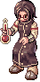
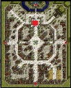
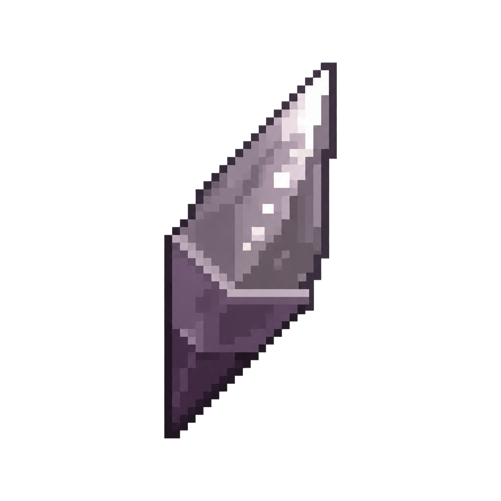

# Reset Stats — The Great Alchemist

**The Great Alchemist** is the Stat Reset NPC in Prontera. He can reset all of your allocated stats back to **1** and return your status points so you can rebuild your character's stat distribution.

## NPC Location

| NPC | Map | Coordinates |
| --- | --- | --- |
| The Great Alchemist | Prontera | `155,285` |

The Great Alchemist can be found in **Prontera at `155,285`**.

## Required Item

| Required Item | Preview |
| --- | --- |
| **Shard of Odin** |  |

The number of **Shard of Odin** required depends on your **Base Level**.

| Base Level | Shard of Odin Required |
| --- | ---: |
| 1–40 | 1 |
| 41–70 | 2 |
| 71–90 | 3 |
| 91–99 | 4 |

## Before You Reset

The Great Alchemist will only perform the reset when all requirements are met:

- Your **Weight must be 0**.
- Remove your **Cart**.
- Dismount your **Peco Peco or other mount**.
- Remove your **Falcon**.
- Dismount any **Cash Mount**.
- Carry enough **Shard of Odin** for your current Base Level.

If any requirement is not met, the reset will not continue.

## How It Works

1. Prepare the required number of **Shard of Odin** for your Base Level.
2. Make sure your Weight is **0** and remove any Cart, Peco/mount, Falcon, or Cash Mount.
3. Talk to **The Great Alchemist** in Prontera at `155,285`.
4. Choose **Lets reset NOW**.
5. The NPC will check your character and required items.
6. Confirm the reset by choosing **GO!**.
7. The required Shard of Odin items are consumed and all allocated stats are reset to **1**.
8. All of your status points are returned so you can allocate them again.

## What Gets Reset

The service resets your character's allocated stats back to **1** and returns the corresponding status points.

This allows you to rebuild your stat distribution without changing your Base Level, Job Level, or class.

## Quick Reference

- **NPC:** The Great Alchemist
- **Location:** Prontera `155,285`
- **Required Item:** Shard of Odin
- **Base Level 1–40:** 1 Shard of Odin
- **Base Level 41–70:** 2 Shard of Odin
- **Base Level 71–90:** 3 Shard of Odin
- **Base Level 91–99:** 4 Shard of Odin
- **Weight Requirement:** 0
- **Remove Before Reset:** Cart, Peco/mount, Falcon, and Cash Mount
- **Result:** Stats return to 1 and status points are refunded

Return to [NPC & Services](npc-services.md) for other NPC guides.
