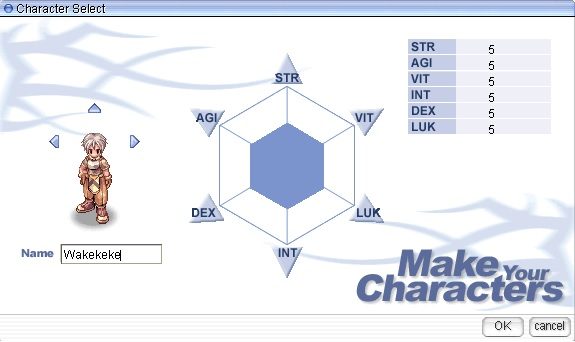
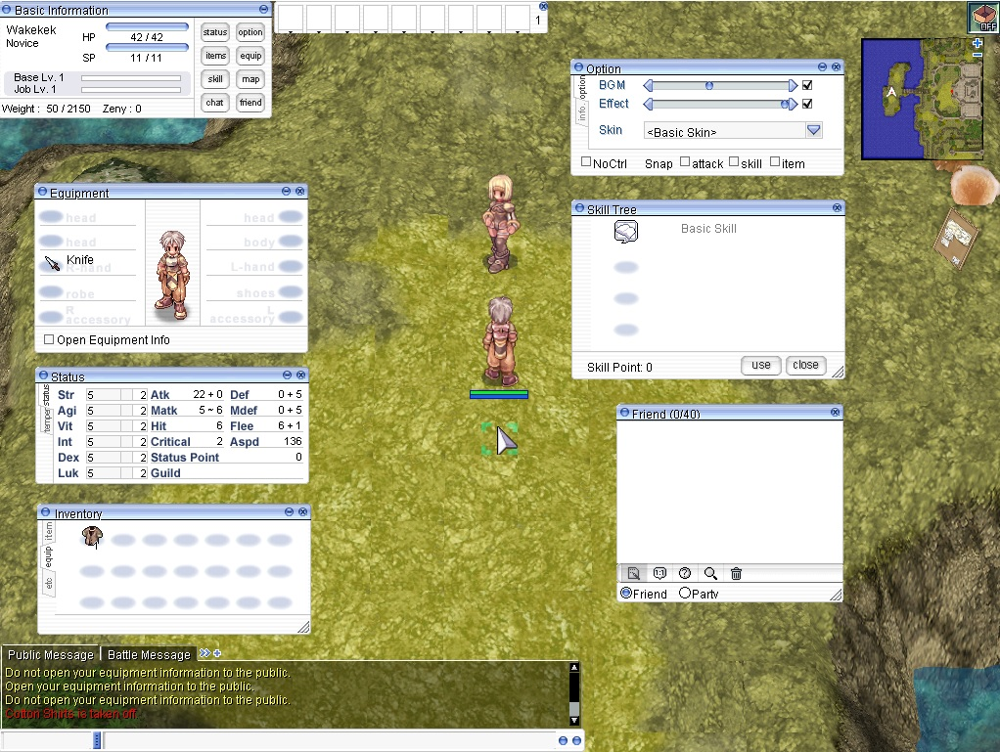
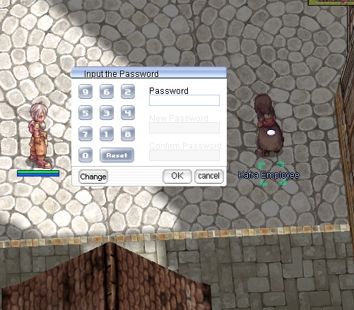
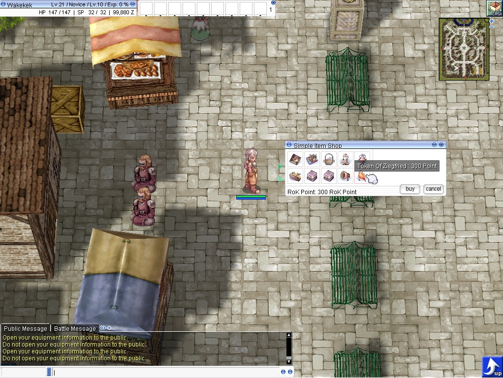

# Server Features

BakbakanRO combines classic Pre-Renewal gameplay with competitive and convenience systems designed for the 99/70 Episode 12 era.

## Classic Pre-Renewal

- Maximum Base / Job Level: 99/70
- Maximum Stat: 99
- Maximum ASPD: 190
- Instant Cast: 150 DEX
- Base EXP / Job EXP / Drop Rate: x1 / x1 / x1
- Maximum Drop Rate: 90%

## Episode 12 World

The playable world is limited to content appropriate for **Episode 12: The Demise of Morroc** and earlier. Third Jobs and later-era progression are not part of the normal server world.

## Classic pRO-Inspired Client Experience

If you played old **pRO**, BakbakanRO is designed to bring back that familiar classic feeling. The user interface and selected client features follow the style many players remember from the old Philippine Ragnarok Online era, helping the game feel immediately familiar while keeping the server focused on classic gameplay.

### Old Classic UI

BakbakanRO preserves an old-school Ragnarok interface style, including the familiar character creation screen and classic in-game window layout used by many pRO players.

### Kafra Storage Password

For added account protection, BakbakanRO supports a **Kafra Storage Password** system inspired by the classic pRO setup.

### Simple Cash Shop

BakbakanRO also includes a **Simple Cash Shop** interface that matches the straightforward and familiar style many players remember from old pRO.

## Classic & Expanded Classes

Alongside the regular and Transcendent class paths, BakbakanRO supports:

- Super Novice
- Taekwon Kid
- Soul Linker
- Taekwon Master
- Ninja
- Gunslinger

## MVP Hunting & PK

Classic MVP hunting is a major part of progression and competition. **PK is enabled on MVP maps**, so players may face other adventurers while competing for MVP monsters and their drops.

BakbakanRO also includes MVP ranking activities for additional competitive goals.

## PvP

Players can test builds, equipment, and teamwork through supported PvP environments and ranking systems.

## War of Emperium

### Temporary Beta Schedule

While BakbakanRO is still in its **Free/Beta stage**, War of Emperium is temporarily scheduled **every day from 8:00 PM to 9:00 PM (GMT+8)**.

This temporary daily schedule gives players and guilds more opportunities to test WoE gameplay, castle participation, balance, and server performance while the server is still being evaluated. The permanent WoE schedule will be finalized later based on the community, guild activity, and overall server population.

| Day | Time |
| --- | --- |
| Every Day | 8:00 PM–9:00 PM |

This schedule is temporary and may change after the Beta stage.

## Premium Account Services

Premium is an optional account-wide service that provides the following benefits while active:

- **+50% EXP Rate**
- **+50% Drop Rate**
- **50% Reduced Death Penalty**
- **Increased Kafra Storage**
- **Access to the Dungeon Teleport NPC and Agit Maps**

Premium is designed to provide additional convenience and progression benefits while preserving BakbakanRO's classic gameplay direction.

## Rankings & Events

BakbakanRO supports competitive and community activities such as PvP rankings, MVP rankings, guild events, Monster Race, and special server events.

---

This page is an overview. More detailed PvP, WoE, Premium, rankings, event, and client feature guides will be added as the wiki expands.
